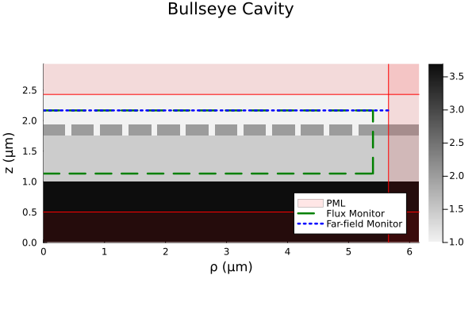
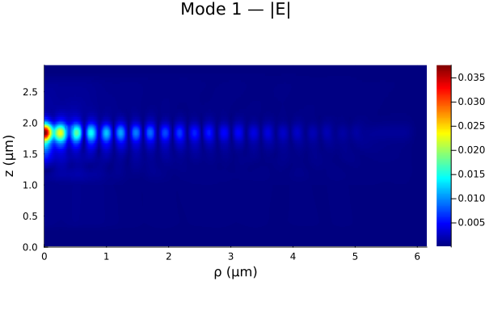
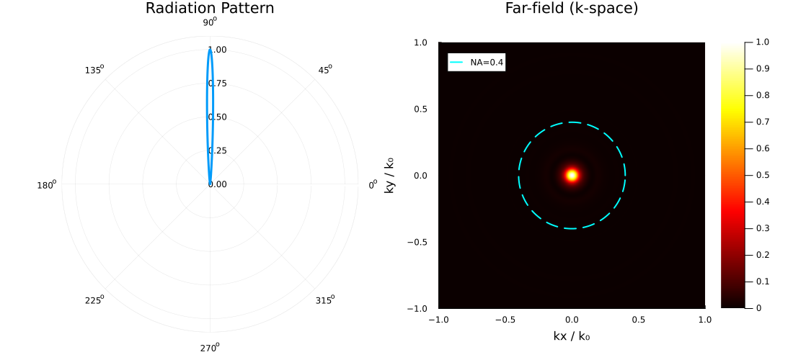

# BullseyeFDFD

[](https://doi.org/10.5281/zenodo.23674812)

A cylindrical FDFD solver for (inverse) designing, simulating, and optimizing Bullseye (Circular Bragg Grating) cavities.

<p align="center">
  
  
</p>

## Installation
In Julia's REPL:
```julia
using Pkg
Pkg.add(url="https://github.com/msanch23/BullseyeFDFD.git")
```
Requires Julia ≥ 1.12.

## Status / Scope
- [X] Forward simulation + modal/driven analysis
- [X] Azimuthal order m
  - [X] m = 1 (in-plane dipole emitters)
  - [ ] m = 0 (axial dipole emitters)
- [X] Convergence + Time/Ram curves — [view the convergence study](validation/convergence/simulation_convergence.ipynb)
- [X] COMSOL Validation — [view the COMSOL sweeps](validation/comsol/comsol_validation.ipynb)
- [X] Adjoint Optimization — [view the gradient check](validation/adjoint/fd_vs_adjoint.ipynb)
  - [X] Eigenvalue
  - [X] Eigenvector
  - [ ] Dipole-Driven
- [ ] Add examples of published papers
- [ ] Experimental Validation

## Features
- Cylindrical (ρ,z) FDFD with azimuthal mode number m = 1
- Unslotted and Slotted Cavities
- Conformal Auto-Meshing
- Anisotropic Subpixel-Smoothed Materials
- Stretched Coordinate-Perfectly Matched Layers (SC-PMLs)
- Eigenmode solver — λ, Q, mode volume, Purcell factor, confinement factor
- Far-field and collection efficiency into a numerical aperture
- Driven-dipole solver — LDOS Purcell factor
- Adjoint gradient optimization (L-BFGS-B) of feature widths and layer thicknesses, with λ, Q, V, Fp, η and ηG targets

## Usage
### Bullseye Design
The eye, trenches, rings, and buffer are each a radial __width__ (μm), laid down outward from the center (ρ=0).
So the whole cavity is one vector:
```julia
design = [0.355000,             # eye radius
          0.100000, 0.370000,   # trench 1, ring 1
          0.100000, 0.370000,   # trench 2, ring 2
          0.100000, 0.370000,   # trench 3, ring 3
          0.100000, 0.370000,   # trench 4, ring 4
          0.100000, 0.370000,   # trench 5, ring 5
          0.100000, 0.370000,   # trench 6, ring 6
          0.100000, 0.370000,   # trench 7, ring 7
          0.100000, 0.370000,   # trench 8, ring 8
          0.100000, 0.370000,   # trench 9, ring 9
          0.100000, 0.370000,   # trench 10, ring 10
          0.100000];            # buffer width
```
To turn the design into a geometry, we need to specify materials and thicknesses for both the cavity and substrates:
```julia
nClad = 1.00;
nSiN  = 2.01066;
nSiO2 = 1.45375;
nSi   = 3.69476 - 1im*0.00482; # Note the -i for loss

tCBG  = 0.17886;
tSiO2 = 0.75057;

substrates = [(n = nSiO2,   height = tSiO2), 
              (n = nSi,     height = Inf)];

geometry = build_geometry(design, substrates, nClad, nSiN, tCBG);
```
For a slotted cavity, pass `slotted=true`; the first entry is then the central slot width, i.e. `design = [slot, eye, trench1, ring1, …, buffer]`.

### Mesh & Visualization
To mesh the geometry, we need to specify a target λ since `conformal_grid()` calculates the size of the cell based on the simulation wavelength:
```julia
λ0 = 0.780;
grid = conformal_grid(geometry, λ0);
```
Then we can paint the Bullseye geometry on to the grid, and plot the cross-section for verification:
```julia
ϵ = build_epsilon(geometry, grid);

show_sim(ϵ, grid);
```
Which should produce a cross-section plot of the Bullseye geometry:
<p align="center">
  
</p>

### Solving & Analysis
#### Eigenfrequency
For solving the eigenfrequency, we just have to specify `Nmodes`:
```julia
sim = solve_sim(grid, ϵ, λ0;
                Nmodes=3);
```
running it will produce the following table:
<!-- readme:assets/readme/sanchez_eig.txt -->
```
Eigenmode Analysis Report
==========================================================
mode | λ (nm)  | Q      | V(λ/n)³ | Fp    | CF     | PML  
----------------------------------------------------------
1    | 780.02  | 356.6  | 2.2295  | 12.2  | 0.1274 | 0.010
2    | 784.21  | 26.6   | 35.5034 | 0.1   | 0.0095 | 0.894
3    | 776.78  | 25.6   | 27.9905 | 0.1   | 0.0135 | 0.870
==========================================================
```
<!-- /readme:assets/readme/sanchez_eig.txt -->
Note that `mode 1` is the fundamental mode, and `mode 2` & `mode 3` are spurious/leaky modes.
Their λ and Q repeat, but their fields depend on the eigensolver's start vector, and ARPACK draws a new pseudo-random one for every solve in a Julia session. So their V, Fp, Gauss. and CF change between the tables below and can differ in your session; mode 1's don't.
and if we specify a numerical aperture:
```julia
NA = 0.4;

@time sim = solve_sim(grid, ϵ, λ0, NA;
                      Nmodes=3);
```
columns are added for figure-of-merits involving the NA:
<!-- readme:assets/readme/sanchez_eig_na.txt -->
```
Eigenmode Analysis Report
============================================================================
mode | λ (nm)  | Q      | V(λ/n)³ | Fp    | η (%)  | Gauss. | CF     | PML  
----------------------------------------------------------------------------
1    | 780.02  | 356.6  | 2.2295  | 12.2  | 16.17  | 0.4803 | 0.1274 | 0.010
2    | 784.21  | 26.6   | 13.1859 | 0.2   | 0.00   | 0.5041 | 0.0195 | 0.894
3    | 776.78  | 25.6   | 8.8425  | 0.2   | 0.00   | 0.5037 | 0.0285 | 0.870
============================================================================
```
<!-- /readme:assets/readme/sanchez_eig_na.txt -->
Plots of the electric field, far-field, and k-space are automatically generated.
<p align="center">
  
  
</p>

#### Driven Dipole & Purcell
To drive the cavity with a point dipole at a specified wavelength and get its LDOS Purcell factor, pass a `source`:
```julia
λ_drive = 0.781;
src = dipole(grid, λ_drive);

sim = solve_sim(grid, ϵ, λ0;
                      source=src);
```
Running the solver produces the following lines:
<!-- readme:assets/readme/sanchez_driven.txt -->
```
Purcell factor = 6.450 @ 781.00 nm
ρ polarized dipole @ (ρ,z): (2, 123)
```
<!-- /readme:assets/readme/sanchez_driven.txt -->
A normalization simulation for the Purcell enhancement happens after the Bullseye-dipole simulation.

#### Both eigenfrequency and driven dipole
Leaving the wavelength out of the source will cause the driven simulation to use a dipole at the eigenfrequency:
```julia
src = dipole(grid);

@time sim = solve_sim(grid, ϵ, λ0, NA;
                      Nmodes=3, source=src);
```
which produces the following:
<!-- readme:assets/readme/sanchez_eig_driven.txt -->
```
Eigenmode Analysis Report
============================================================================
mode | λ (nm)  | Q      | V(λ/n)³ | Fp    | η (%)  | Gauss. | CF     | PML  
----------------------------------------------------------------------------
1    | 780.02  | 356.6  | 2.2295  | 12.2  | 16.17  | 0.4803 | 0.1274 | 0.010
2    | 784.21  | 26.6   | 2.7450  | 0.7   | 0.00   | 0.4689 | 0.0053 | 0.894
3    | 776.78  | 25.6   | 33.8040 | 0.1   | 0.00   | 0.4593 | 0.0118 | 0.870
============================================================================

Purcell factor = 10.466 @ 780.02 nm
ρ polarized dipole @ (ρ,z): (2, 123)
```
<!-- /readme:assets/readme/sanchez_eig_driven.txt -->
The returned `sim` carries both solves:
```julia
sim.modes[1].Q         # eigenmode quantities (Q, V_eff, Fp, CF, η, gaussicity)
sim.driven.Purcell     # LDOS Purcell factor (P_struct / P_bulk)
sim.driven.normE       # |E| of the driven field
```
### Optimization
Adjoint gradients and L-BFGS-B optimize the feature widths, and optionally tCBG and the substrate thicknesses, within bounds.
#### Figures of Merit
The figures of merit are given as a list:
```julia
FOMs = [λ_target(0.780), Q_target(:max)];   # maximize Q at λ = 0.780 µm

FOMs = [λ_target(0.7825; σ=0.005, kind=:penalty), Q_target(78.25; w=50),
        V_target(:min), η_target(:max), ηG_target(:max)];   # min V, max η and ηG at λ = 0.7825 µm, Q ≈ 78.25
```
- `:max`/`:min` terms are rewards that multiply: Q, Fp, η, ηG and 1/V. `Q_target(:max)` with `V_target(:min)` is proportional to `Fp_target(:max)` (Q/V = 4π²/3 · Fp).
- `λ_target` multiplies that product by a Lorentzian of width σ around λ0; with `kind=:penalty` it adds ((λ − λ0)/σ)² instead.
- Terms with a target value add a penalty w·((x − x0)/x0)².
- `adj_opt` minimizes J = −(product) + penalties.
- η and ηG are computed through an aperture, so pass `NA=…` to `adj_opt`.
#### Running an Optimization
`opt_kwargs` sets the bounds on every width and, optionally, the slab (tCBG) and substrate thicknesses, in µm.
It is recommended to use a coarser grid for the optimization; we trade a slight simulation error for quicker evaluations ([convergence study](validation/convergence/simulation_convergence.ipynb)).
```julia
grid_kwargs = (; λPts=24, geoPts=8);
opt_kwargs  = (; nClad, nCBG=nSiN, λ=0.780, NA=0.4, # If η, ηG are missing from FOMs, then any defined NA is ignored.
                 lower=fill(0.05, length(design)), upper=fill(1.00, length(design)),
                 thickness=(; tCBG=(0.15, 0.22), substrate1=(0.65, 0.85)),
                 Nmodes=10, grid_kwargs,
                 save_data=@__FILE__, label="sanchez");

res1 = adj_opt(design, FOMs; substrates, tCBG, opt_kwargs...); # First round takes bullseye and substrate thicknesses
res2 = adj_opt(res1, FOMs; opt_kwargs...); # later rounds continue from the previous result (design, thicknesses, tracked mode)
res3 = adj_opt(res2, FOMs; opt_kwargs...);
```
Each round builds a grid conformal to its starting design and keeps it fixed; as the widths move, the interfaces drift off the grid lines.
To avoid optimizing for a stale grid, it is recommended to reoptimize the first round's result - usually a few more percent of performance is found. Stop the optimization loop once the optimizations no longer improve J.
A round stops when J improves by less than 1e-4·|J| for 3 iterations, or at `iterations` (default 200).
Each run writes `results/<yymmdd-HHMMSS>_<label>/` next to the script, containing `round<k>.csv` and a copy of the script. It also adds one row per round to `results/index.csv`.

#### Results
Here's what's available after an optimization round:
```julia
res3.design       # optimized widths (µm)
res3.tCBG         # optimized slab thickness
res3.substrates   # substrates with the optimized heights
res3.fom          # best J, with res3.mode = (λ, Q) at that point
```
`adj_opt` returns the lowest-J evaluation of the round, not the optimizer's last step.

The optimization's numbers come from the coarse grid each round froze. Evaluate the optimized design on a fresh grid at the accurate setting (36, 24). 
```julia
geometry = build_geometry(res3.design, res3.substrates, nClad, nSiN, res3.tCBG);
grid     = conformal_grid(geometry, λ0; λPts=36, geoPts=24);
ϵ        = build_epsilon(geometry, grid);
sim      = solve_sim(grid, ϵ, λ0; Nmodes=10);   # add NA for η and ηG
```
There are two examples found under `examples/`:
  - [examples/adjopt_sanchezBullseye.jl](examples/adjopt_sanchezBullseye.jl): target λ and maximum Q, with thickness optimization.
  - [examples/adjopt_perovskiteBullseye.jl](examples/adjopt_perovskiteBullseye.jl): slotted cavity, with target λ, target Q, minimum V, maximum η and ηG.

## Validation
Two independent checks: the physics against a commercial finite-element solver (COMSOL), and the gradients against brute-force finite differences.
### COMSOL
To validate the solver with commercial software, we compare parameter (rEye, tCBG, tSiO2) sweeps between COMSOL and BullseyeFDFD: [COMSOL sweeps](validation/comsol/comsol_validation.ipynb)

Ratios are FDFD/COMSOL, and r is the correlation along the sweep (how well the trends track).
"Same-mode points" counts the points where both solvers report the same mode. The one rEye exclusion, at 0.31 µm, is where the design mode tunes out of the search window.
<!-- readme:validation/comsol/results/summary.csv -->
| Sweep | Quantity | Same-mode points | FDFD/COMSOL mean | FDFD/COMSOL std | Max. difference (%) | Correlation r |
| --- | --- | --- | --- | --- | --- | --- |
| rEye | λ (nm) | 9/10 | 0.9998 | 0.0000 | 0.03 | 1.0000 |
| rEye | Q | 9/10 | 0.9750 | 0.0110 | 4.73 | 0.9999 |
| rEye | V (λ/n)³ | 9/10 | 1.0158 | 0.0053 | 2.56 | 1.0000 |
| rEye | Fp | 9/10 | 0.9599 | 0.0156 | 7.48 | 1.0000 |
| rEye | CF | 9/10 | 0.9928 | 0.0072 | 2.69 | 1.0000 |
| rEye | Ceff_NA | 9/10 | 1.0159 | 0.0154 | 3.78 | 0.9932 |
| tCBG | λ (nm) | 9/9 | 0.9998 | 0.0000 | 0.02 | 1.0000 |
| tCBG | Q | 9/9 | 0.9869 | 0.0023 | 1.54 | 0.9997 |
| tCBG | V (λ/n)³ | 9/9 | 1.0124 | 0.0019 | 1.44 | 0.9994 |
| tCBG | Fp | 9/9 | 0.9748 | 0.0022 | 2.87 | 0.9983 |
| tCBG | CF | 9/9 | 0.9969 | 0.0020 | 0.56 | 0.9956 |
| tCBG | Ceff_NA | 9/9 | 1.0036 | 0.0007 | 0.45 | 0.9994 |
| tSiO2 | λ (nm) | 19/19 | 0.9998 | 0.0000 | 0.02 | 0.9986 |
| tSiO2 | Q | 19/19 | 0.9908 | 0.0040 | 1.59 | 0.9992 |
| tSiO2 | V (λ/n)³ | 19/19 | 1.0099 | 0.0026 | 1.38 | 0.9789 |
| tSiO2 | Fp | 19/19 | 0.9811 | 0.0058 | 2.85 | 0.9979 |
| tSiO2 | CF | 19/19 | 0.9989 | 0.0025 | 0.48 | 0.9930 |
| tSiO2 | Ceff_NA | 19/19 | 0.9973 | 0.0106 | 2.29 | 0.9989 |

*λPts: 36 · geoPts: 24*
<!-- /readme:validation/comsol/results/summary.csv -->
- λ agrees to 0.03 % (≈ 0.2 nm). The gap closes with refinement: the convergence study extrapolates λ = 780.22 ± 0.13 nm, against COMSOL's 780.20.
- CF and Ceff_NA agree on average within about 1–2 %.
- Q reads 1–2.5 % lower and V 1–1.6 % higher than COMSOL, and Fp inherits both (2–4 % low).
- Every quantity tracks along the sweeps: r ≥ 0.97.

### Adjoint gradients
The adjoint gradients of J and of each observable (λ, Q, V, Fp, ηG, η) are compared against central finite differences that re-solve the eigenproblem, for all 24 parameters (22 widths, tCBG, tSiO2) of the 10-ring design above, on the optimization grid (24, 8): [gradient check](validation/adjoint/fd_vs_adjoint.ipynb) 

<!-- readme:validation/adjoint/results/summary.csv -->
| Observable | Median rel. error | Max. rel. error |
| --- | --- | --- |
| J | 6.6e-09 | 1.5e-07 |
| λ | 3.3e-09 | 1.2e-06 |
| Q | 7.3e-09 | 5.8e-08 |
| V | 7.6e-09 | 4.6e-06 |
| Fp | 6.1e-09 | 1.8e-06 |
| ηG | 4.8e-08 | 3.9e-06 |
| η | 3.1e-08 | 1.9e-06 |

*Parameters: 24 · FD step δ: 1e-07 · λPts: 24 · geoPts: 8*
<!-- /readme:validation/adjoint/results/summary.csv -->
Median relative error about 10⁻⁸, maximum below 5 × 10⁻⁶. 
## Testing
BullseyeFDFD comes with a test suite for geometry, meshing, materials, curl operators, and both the eigenmode and driven solves.
```julia
using Pkg
Pkg.test("BullseyeFDFD")
```

## Theory
The derivations behind the solver are (in-progress) written up in [`notes/`](notes/).

## Citation
Please cite the software through its Zenodo DOI. The DOI below always resolves to the latest release; for exact reproducibility, cite the DOI of the version you used, listed on the Zenodo page. A paper is in preparation.
```bibtex
@misc{sanchez_bullseyefdfd_2026,
  author    = {Sanchez, Martin},
  title     = {{BullseyeFDFD}: a cylindrical FDFD solver for
               bullseye (circular Bragg grating) cavities},
  year      = {2026},
  publisher = {Zenodo},
  doi       = {10.5281/zenodo.23674812},
  url       = {https://doi.org/10.5281/zenodo.23674812}
}
```

## License
Released under the MIT License — see [`LICENSE`](LICENSE).
